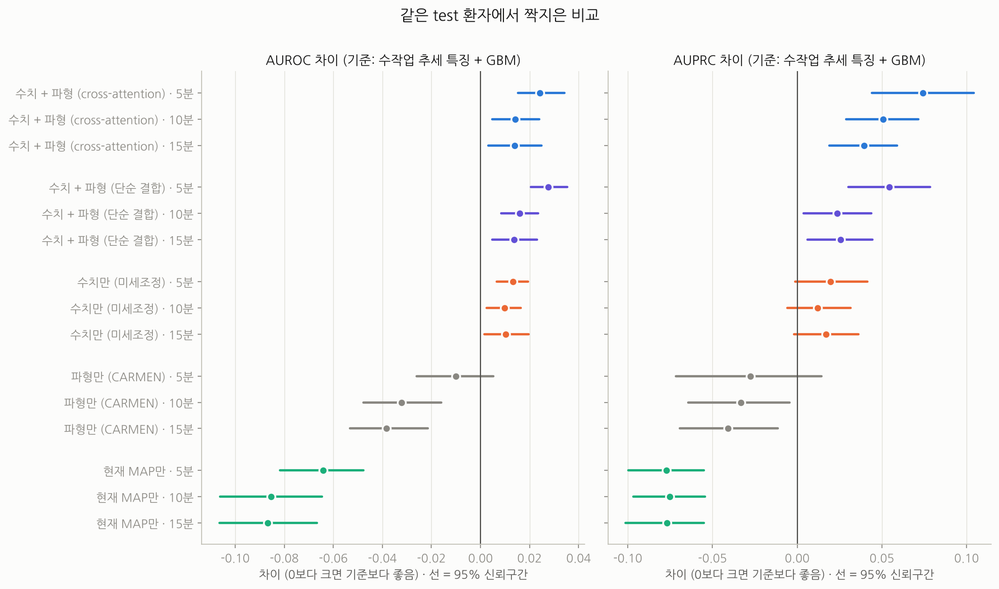
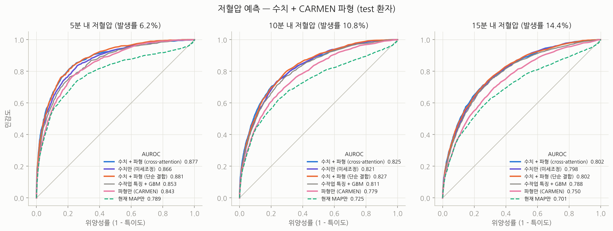

# 수치(UniTTab) + CARMEN 파형 cross-attention — 수술 중 저혈압 예측 (2026-11-25)

같은 표본·같은 환자 분할(test 371 케이스, 12,536 예측 시점)에서 `2026-11-25_signal_only_ioh.md` 의 수치 전용
결과와 비교한다. 예측 시점: 5분마다, 직전 5분 ART MAP 가 모두 ≥ 65. 정답: 5/10/15분 안에 ART MAP < 65.

## 설정

| 항목 | 값 |
| --- | --- |
| 파형 | 예측 시점에서 끝나는 직전 60 s 의 ABP (`SNUADC/ART`), ECG II, PPG — 미래 없음 |
| 전처리 | CARMEN 사전학습과 동일: 범위 검사, median(ABP/PPG), 60 Hz notch(ECG/PPG), Butterworth (ECG 0.5–40, ABP 15, PPG 8 Hz) @500 Hz → 100 Hz; 결측 > 30% 또는 평탄하면 그 신호 없음 |
| 파형 보유율 (test) | ECG 99.3%, ABP 99.0%, PPG 93.5% |
| CARMEN | Base 174M, 고정(frozen), 한 샘플의 세 신호를 함께(any-variate) 인코딩 → 0.25 s 패치를 5 s 로 평균 → 샘플당 36 토큰 (3 신호 × 12) |
| 수치 encoder | 신호 전용 UniTTab (`unittab_signal_v1`, 6k step) — 미세조정 (lr 1e-5) |
| cross-attention | query = 수치 [CLS, 마지막 행, 행 평균], key/value = 투영한 CARMEN 토큰 + "파형 없음" 토큰; 2 블록 (d 512, 8 heads); head lr 3e-4 |
| 대조군 | 파형만 (학습 query, 수치 없음) · 단순 결합 (수치 3토큰 + 파형 평균을 이어 붙임) |
| 선택 | val 평균 AUROC 로 조기 종료 (fusion 800 · late 700 · wave 3000 step) |

## 결과 (test) — AUROC (AUPRC)

| 방법 | 5분 | 10분 | 15분 |
| --- | --: | --: | --: |
| 현재 MAP 만 | 0.789 (0.294) | 0.725 (0.315) | 0.701 (0.341) |
| 수작업 추세 특징 + GBM | 0.853 (0.371) | 0.811 (0.390) | 0.788 (0.418) |
| 파형만 (CARMEN) | 0.843 (0.343) | 0.779 (0.357) | 0.750 (0.377) |
| 수치만 (미세조정) | 0.866 (0.391) | 0.821 (0.403) | 0.798 (0.435) |
| 수치 + 파형 단순 결합 | **0.881** (0.425) | **0.827** (0.414) | 0.802 (0.444) |
| **수치 + 파형 cross-attention** | 0.877 (**0.445**) | 0.825 (**0.441**) | 0.802 (**0.458**) |

짝지은 patient bootstrap (1,000회) 차이 [95% CI]:

| 비교 | | 5분 | 10분 | 15분 |
| --- | --- | --: | --: | --: |
| cross-attention − 수치만 | ΔAUROC | +0.011 [+0.004, +0.018] | +0.004 [−0.003, +0.012] | +0.004 [−0.003, +0.011] |
| | ΔAUPRC | **+0.055 [+0.029, +0.078]** | **+0.039 [+0.019, +0.058]** | **+0.022 [+0.005, +0.040]** |
| cross-attention − 단순 결합 | ΔAUROC | −0.003 [−0.011, +0.003] | −0.002 [−0.008, +0.005] | +0.000 [−0.007, +0.007] |
| | ΔAUPRC | +0.020 [−0.003, +0.043] | **+0.027 [+0.008, +0.046]** | +0.014 [−0.004, +0.031] |
| cross-attention − GBM | ΔAUROC | +0.024 [+0.015, +0.034] | +0.014 [+0.005, +0.024] | +0.014 [+0.003, +0.025] |
| | ΔAUPRC | +0.074 [+0.044, +0.104] | +0.051 [+0.029, +0.071] | +0.039 [+0.019, +0.059] |

5분 예측 경보 운용점 (민감도 → PPV, 시간당 경보 / 그중 오경보):

| 민감도 | cross-attention | 수치만 | GBM |
| --- | --- | --- | --- |
| 50% | 40.3%, 0.93 / 0.55 | 37.8%, 0.99 / 0.62 | 34.4%, 1.09 / 0.71 |
| 70% | 27.0%, 1.94 / 1.42 | 24.5%, 2.14 / 1.62 | 22.9%, 2.30 / 1.77 |
| 80% | 21.4%, 2.80 / 2.20 | 18.9%, 3.18 / 2.58 | 16.4%, 3.65 / 3.05 |

## 해석

1. **파형을 붙이면 정밀도(AUPRC)가 확실히 오른다**: 수치만 대비 +0.055 (5분, 상대 +14%), +0.039, +0.022 —
   세 지평 모두 유의. AUROC 이득은 5분에서만 유의(+0.011). 위험이 높다고 고른 시점의 적중률이 오르는 쪽의
   개선이고, 지평이 짧을수록 크다 — 직전 60 s 파형은 가까운 미래에 더 정보가 많다.
2. **파형만으로는 부족하다**: 60 s 파형 단독은 GBM 보다 낮고(10·15분 유의) 지평이 길수록 차이가 커진다.
   몇 시간의 추세(수치)와 직전 1분의 파형 모양(CARMEN)이 서로 보완한다.
3. **cross-attention vs 단순 결합**: AUROC 는 같고, AUPRC 는 cross-attention 이 +0.014–0.027 높다(10분만 유의).
   융합 방식보다 "파형 정보를 넣는 것" 자체의 효과가 크다.
4. **실사용 관점 (5분, 민감도 80%)**: 오경보가 시간당 3.05 (GBM) → 2.58 (수치) → 2.20 (융합)회로 준다.

## 주의

* VitalDB 는 CARMEN 사전학습 코퍼스와 같은 병원 데이터 — 일부 test 환자의 파형이 CARMEN 사전학습(자기지도)에
  쓰였을 수 있다. 저혈압 정답은 보지 않았지만 파형 표현이 test 에 다소 유리할 수 있다 (논문 평가처럼 중복
  환자를 제거해야 엄밀).
* 단일 seed. cross-attention vs 단순 결합 차이는 작아 seed 반복이 필요.
* 융합 모델의 위험 추이 그림은 예측 시점(5분 간격, 적격 시점만)에서만 계산했다 — 분 단위 비교는 아직.
