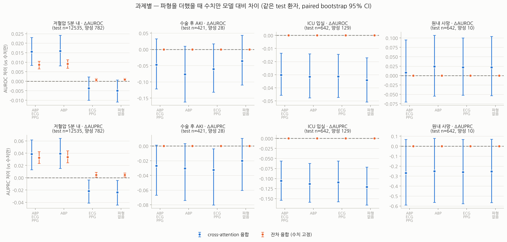
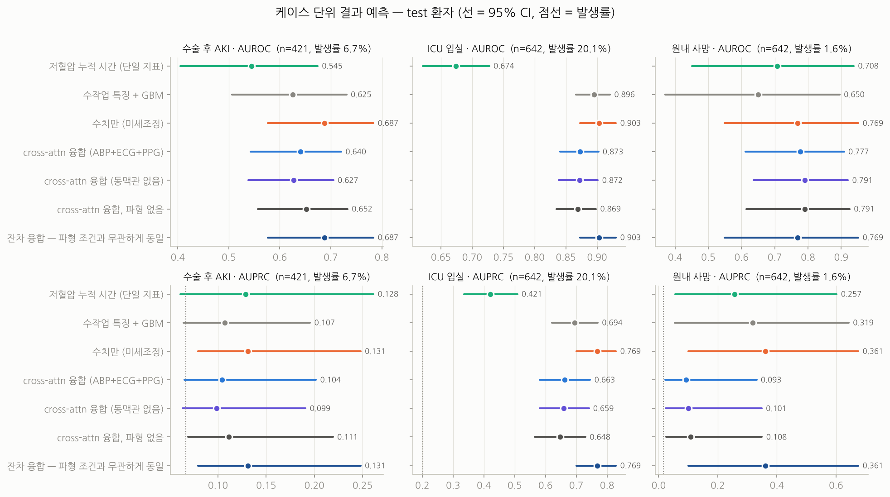
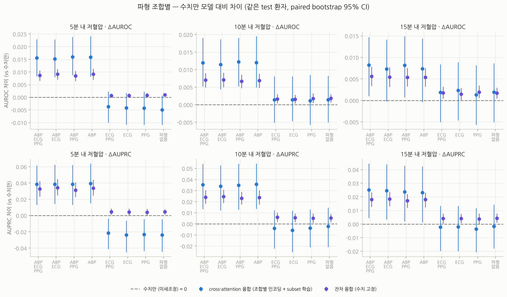

# 다른 downstream 과제로 확장 — AKI · ICU 입실 · 원내 사망 (+ 저혈압 재확인) (2026-11-25)

저혈압(IOH)용 파이프라인(수치 encoder 미세조정 → CARMEN 파형 융합 → 짝지은 bootstrap 비교)을 그대로
케이스 단위 결과 예측 3종에 적용했다. 모든 스크립트는 `--task {ioh,aki,icu,mortality}` 하나로 전환된다
(`scripts/downstream_tasks.py`). 입력은 지금까지와 같이 **신호에서 나온 정보만** 쓴다 (약물·BIS·검사·수술 전 정보 없음).
정답(label)만 `clinical_data.csv` / `lab_data.csv` 에서 가져온다.

## 과제 정의

| 과제 | 정답 | 예측 시점 · 입력 |
| --- | --- | --- |
| `aki` | 수술 후 AKI (KDIGO 크레아티닌: 수술 후 7일 내 최대 ≥ 1.5 × 수술 전, 또는 48 h 내 +0.3 mg/dL). 수술 전·후 크레아티닌이 없는 케이스는 제외 | 마취 기록의 마지막 모니터 행. 수치 = 마지막 창, 파형 = 케이스 전체에 고르게 흩은 60 s 창 12개 (신호·창마다 CARMEN 토큰 1개) |
| `icu` | 수술 후 ICU 입실 (`icu_days > 0`) | 같음 |
| `mortality` | 원내 사망 (`death_inhosp`) | 같음 |
| `ioh` | 5/10/15분 내 ART MAP < 65 | 5분마다 (기존과 동일; `2026-11-25_carmen_fusion_ioh.md`) |

케이스 분할은 IOH 와 같은 환자 단위 분할: train 5,098 · val 635 · test 642 케이스 (AKI 는 크레아티닌이 있는 421 케이스).
test 양성 수: **AKI 28 · ICU 129 · 사망 10.** ICU 만 통계적 검정력이 있다.

## 비교한 모델

| 이름 | 내용 |
| --- | --- |
| 저혈압 누적 시간 | MAP < 65 분 수 하나 (단일 지표 기준선) |
| 수작업 특징 + GBM | 케이스 요약 15개 (길이, MAP 평균·최소·<65 분·비율·AUC, HR, SpO2 최저·탈포화 분, EtCO2, 체온, TV, 동맥관 여부) |
| 수치만 (미세조정) | 신호 전용 UniTTab (`unittab_signal_v1`) 을 과제별로 미세조정 (`finetune_ioh.py --task`) |
| cross-attn 융합 | `finetune_fusion.py --mode fusion` — 조합별 CARMEN 인코딩 + subset 학습 (IOH 에서 쓰던 설정 그대로) |
| **잔차 융합 (수치 고정)** | 새로 추가: `--mode gated --freeze-numeric --init-from <수치만 best.pt>`. 위 수치 모델의 head 출력에 파형 분기 출력을 **더한다**. 파형 분기의 마지막 층은 0으로 초기화하므로 step 0 = 수치 모델과 정확히 같고, 수치 encoder·head 는 고정한 채 파형 분기만 학습한다. step 0 도 val 선택 후보에 들어간다 |

잔차 융합을 만든 이유: ICU 에서 cross-attn 융합이 **파형이 없을 때조차** 수치만 모델보다 유의하게 나빴다 (아래).
파형 때문이 아니라 구조 때문에 손해를 본다는 뜻이다. 사전학습된 head 를 무작위 초기화한 cross 블록으로 바꾸고,
학습 표본은 5,098개뿐이다. 그래서 "수치 모델을 절대 망가뜨리지 않고, 파형이 도움이 될 때만 더하는" 형태가 필요했다.
(encoder 까지 같이 풀어 둔 잔차 융합은 IOH 를 포함한 네 과제 모두 val 에서 step 0 이 선택되어 수치 모델과 같아졌다. 그래서 수치 쪽을 고정했다.)

## 결과 — 한 그림 요약



수치만 모델과의 짝지은 차이 (같은 test 환자, patient bootstrap 95% CI; 케이스 과제는 1,000회, IOH 는 500회).
x축 = 시험 때 주어진 파형 조합.

### 케이스 과제 (test) — AUROC (AUPRC)

| 방법 | AKI (n 421, 양성 28) | ICU 입실 (n 642, 양성 129) | 원내 사망 (n 642, 양성 10) |
| --- | --: | --: | --: |
| 저혈압 누적 시간 | 0.545 (0.128) | 0.674 (0.421) | 0.708 (0.257) |
| 수작업 특징 + GBM | 0.625 (0.107) | 0.896 (0.694) | 0.650 (0.319) |
| **수치만 (미세조정)** | **0.687 (0.131)** | **0.903 (0.769)** | **0.769 (0.361)** |
| cross-attn 융합, ABP+ECG+PPG | 0.640 (0.104) | 0.873 (0.663) | 0.777 (0.093) |
| cross-attn 융합, 동맥관 없음 (ECG+PPG) | 0.627 (0.099) | 0.872 (0.659) | 0.791 (0.101) |
| cross-attn 융합, 파형 없음 | 0.652 (0.111) | 0.869 (0.648) | 0.791 (0.108) |
| 잔차 융합 (모든 파형 조건) | 0.687 (0.131) | 0.903 (0.769) | 0.769 (0.361) |



수치만 모델 대비 차이 [95% CI]:

| | AKI ΔAUROC | ICU ΔAUROC | ICU ΔAUPRC | 사망 ΔAUROC |
| --- | --: | --: | --: | --: |
| 수작업 GBM | −0.062 [−0.172, +0.048] | −0.008 [−0.030, +0.016] | **−0.074 [−0.134, −0.016]** | **−0.119 [−0.241, −0.008]** |
| cross-attn, ABP+ECG+PPG | −0.047 [−0.122, +0.033] | **−0.030 [−0.046, −0.014]** | **−0.106 [−0.154, −0.056]** | +0.008 [−0.070, +0.095] |
| cross-attn, 파형 없음 | −0.035 [−0.110, +0.043] | **−0.034 [−0.051, −0.017]** | **−0.121 [−0.166, −0.072]** | +0.022 [−0.054, +0.104] |
| 잔차 융합 | 0 (= 수치만) | 0 | 0 | 0 |

잔차 융합의 파형 분기는 학습되기는 했지만 val 을 한 번도 넘지 못했다 (val AUROC, 50 step 마다):

| 과제 | step 0 (= 수치만) | 50 | 100 | 250 | 500 | 학습 loss @500 |
| --- | --: | --: | --: | --: | --: | --: |
| AKI | **0.779** | 0.778 | 0.769 | 0.752 | 0.766 | 1e-4 |
| ICU | **0.934** | 0.934 | 0.933 | 0.911 | 0.914 | 0.02 |
| 사망 | **0.880** | 0.876 | 0.839 | 0.871 | 0.798 | 0.01 |

→ 파형 분기는 수십 step 만에 train 을 외우고(loss → 0), val 은 내려가기만 한다. 그래서 선택된 모델은 step 0 = 수치 모델이다.

### 저혈압 (IOH) — 같은 잔차 융합을 8가지 파형 조건에서



| 5분 내 저혈압, 수치만 대비 | ΔAUROC | ΔAUPRC |
| --- | --: | --: |
| cross-attn (조합별 인코딩 + subset 학습), ABP 있음 (eap/ea/ap/a) | +0.015 ~ +0.016 [≈ +0.008, +0.024] | +0.038 ~ +0.039 [≈ +0.013, +0.064] |
| cross-attn, ABP 없음 (ep/e/p/none) | −0.004 ~ −0.005 [≈ −0.011, +0.002] | **−0.021 ~ −0.024 [≈ −0.044, −0.003]** |
| **잔차 융합, ABP 있음** | **+0.009 [+0.007, +0.011]** | **+0.033 [+0.024, +0.043]** |
| **잔차 융합, ABP 없음** | **+0.001 [+0.000, +0.002]** | **+0.005 [+0.001, +0.009]** |

10/15분에서도 같은 양상이다. 잔차 융합의 ABP 있음 이득은 10분 +0.007 / +0.024, 15분 +0.006 / +0.018 (AUROC / AUPRC; CI 모두 0 위).
ABP 없음은 +0.002 / +0.004 ~ +0.005 (CI 0 위)이다. 잔차 융합은 val 에서 step 300 이 선택됐다 (0.8627 → 0.8643).

## 해석

1. **파이프라인은 다른 과제에서도 그대로 동작한다.** 같은 스크립트에 `--task` 만 바꿔 미세조정, 파형 토큰 추출,
   융합, 짝지은 비교까지 끝까지 돌았다. 파형 조합 8가지와 파형 없음도 케이스 과제에서 똑같이 처리된다.
2. **케이스 과제에서는 수치만 모델이 가장 좋다.** 수작업 GBM 보다 ICU AUPRC (+0.074) 와 사망 AUROC (+0.119) 에서 유의하게 높다.
   다만 사망은 양성이 10명이라 CI 하한이 −0.008 근처이고, 이 차이는 흔들릴 수 있다.
3. **케이스 과제에서 CARMEN 파형은 아직 도움이 되지 않는다.**
   - cross-attn 융합은 ICU 에서 −0.030 AUROC / −0.11 AUPRC 로 유의하게 나쁘다. 파형이 없어도 똑같이 나쁘다 →
     손해의 원인은 파형이 아니라 구조와 표본 수이다.
   - 수치 모델을 고정한 잔차 융합은 손해가 0 이지만 이득도 0 이다. 파형 분기가 val 을 한 번도 넘지 못해 수치 모델로 되돌아간다.
4. **저혈압에서는 잔차 융합이 "안전한" 선택이다.** 8가지 조건 모두에서 수치만 모델보다 나쁘지 않다 (CI 하한 ≥ 0).
   ABP 가 있을 때의 이득은 cross-attn 의 약 60% (+0.009 vs +0.016 AUROC, +0.033 vs +0.039 AUPRC) 이다.
   cross-attn 은 이득이 더 크지만, ABP 가 없으면 5분 AUPRC 가 −0.02 내려간다. 즉 **이득 크기와 결측 시 안전성의 교환**이다.
5. **CARMEN 연동 기본값 제안:** 잔차 융합 (수치 고정 + 0-초기화 파형 분기). 어떤 과제·어떤 파형 결측에서도 수치 모델 아래로 내려가지 않고,
   파형 정보가 실제로 있는 과제(IOH + ABP)에서는 이득을 가져온다.
   ABP 가 거의 항상 있는 환경이라면 cross-attn 이 더 큰 이득을 준다.

## 주의 · 확인 필요

- **ICU 입실은 대부분 수술 전에 계획된 결정**일 가능성이 크다 (확인 필요). 신호만으로 AUROC 0.90 이 나오는 것은
  "악화 예측"이라기보다 수술 길이·동맥관 유무 같은 **수술 종류의 대리 변수**를 잡는 것일 수 있다
  (수작업 GBM 에 `duration`, `has_art` 가 있고 0.896 이 나온다). 계획되지 않은 ICU 입실만 따로 보려면 응급 여부·수술 종류로 층화해야 한다.
- **AKI (양성 28) · 사망 (양성 10)** 은 검정력이 부족하다. 점추정 차이 ±0.05 는 잡음 범위이다. 결론을 내리려면 교차검증(케이스 분할 5겹)이나 seed 반복이 필요하다.
- 케이스 과제의 파형 표현(케이스 전체에 60 s 창 12개, 창·신호당 토큰 1개)이 너무 거칠 수 있다. 파형이 쓸모없다는 결론이 아니라,
  **이 표현 + 5천 케이스로는 수치 정보를 넘지 못한다**는 결과이다.
- 모든 숫자는 seed 하나이다.

## 다음 후보

1. 케이스 과제를 5겹 교차검증으로 다시 평가 (특히 AKI·사망).
2. 케이스 파형 분기 정규화 강화: dropout·weight decay ↑, lr ↓, 또는 파형 토큰 평균 + 선형 층만 쓰는 저용량 분기.
3. 케이스 파형 표현 개선: 창 수 ↑, 수술 마지막 30분에 집중, 또는 창별 통계(최소·분산)로 요약.
4. ICU 입실을 응급·예정 수술로 층화.

## 재현 (노드)

```bash
# 케이스 과제 토큰 (12 창 × 신호, 8가지 조합 인코딩)
python scripts/extract_carmen_tokens.py --task icu --label-data $SIG --vital-dir $B/vitaldb/raw \
  --cases-csv $CL --carmen-src $R/carmen_src --weights $R/carmen_weights/carmen-base.pt \
  --out $R/carmen_tokens_case --splits val test train --subsets all
# 과제별 (task = aki / icu / mortality)
T="--task $task --cases-csv $CL --labs-csv $LB --data $SIG --label-data $SIG"
python scripts/finetune_ioh.py $T --ckpt $CK --lr-enc 1e-5 --lr-head 3e-4 --eval-every 50 --patience 10 \
  --out $R/runs/ft_case_$task
python scripts/finetune_fusion.py --mode fusion --token-mode subsets --subset-train 0.4 0.15 \
  --select-conds eap ep none $T --ckpt $CK --tokens $R/carmen_tokens_case --eval-every 50 --patience 10 \
  --out $R/runs/fu_case_$task
python scripts/finetune_fusion.py --mode gated --freeze-numeric --init-from $R/runs/ft_case_$task/best.pt \
  --token-mode subsets --subset-train 0.4 0.15 --select-conds eap ep none $T --ckpt $CK \
  --tokens $R/carmen_tokens_case --eval-every 50 --patience 10 --out $R/runs/fu_gatef_case_$task
python scripts/compare_ioh.py $T --finetuned numeric_ft $R/runs/ft_case_$task/best.pt \
  --scores fusion:eap $R/runs/fu_case_$task/test_scores_eap.npz ... \
  --scores gatef:eap $R/runs/fu_gatef_case_$task/test_scores_eap.npz ... \
  --reference numeric_ft --n-boot 1000 --out $R/runs/compare_gatef_$task.json
# 그림
python scripts/plot_predictions.py compare_gatef_icu.json --out figs \
  --task-delta '저혈압 5분 내' compare_gatef_ioh.json 5 fu_fusion_sub fu_gatef_ioh \
  --task-delta '수술 후 AKI' compare_gatef_aki.json aki fusion gatef \
  --task-delta 'ICU 입실' compare_gatef_icu.json icu fusion gatef \
  --task-delta '원내 사망' compare_gatef_mortality.json mortality fusion gatef \
  --case aki compare_gatef_aki.json --case icu compare_gatef_icu.json --case mortality compare_gatef_mortality.json
```
