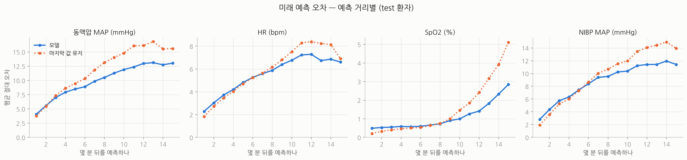
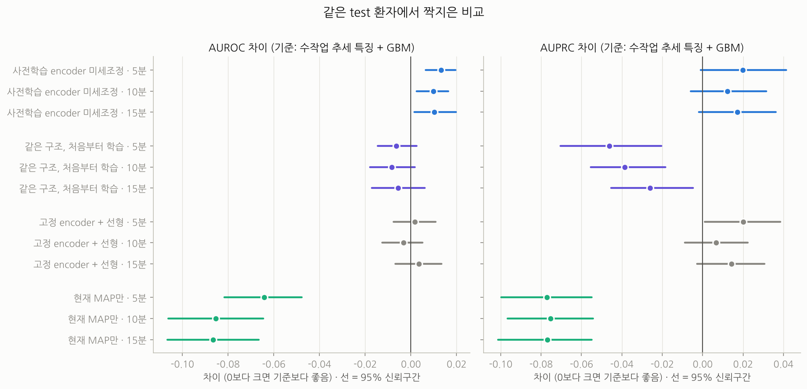
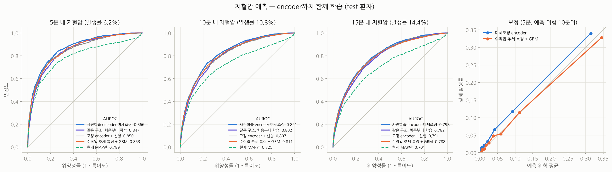

# 신호 전용 UniTTab — 사전학습, 재구성, 수술 중 저혈압 예측 (2026-11-25)

CARMEN 과 같은 성격의 입력만 쓰도록 **환자에게서 측정된 신호 수치만** 남긴 모델. 모든 숫자는
처음 보는 환자(val 635 / test 645 케이스, 환자 단위 분할) 기준.

## 설정

| 항목 | 값 |
| --- | --- |
| 입력 필드 | HR, SpO2, ART SBP/DBP/MAP, NIBP SBP/DBP/MAP, EtCO2, RR, 체온, TV, PIP (`--profile signal`) |
| 제외 | 프로포폴·레미펜타닐 Ce, MAC, BIS, FiO2, PEEP, 검사 수치, 수술 전 정보 |
| 캐시 | VitalDB 6,388 케이스, 1,156,972행 (bin 경계는 전체 필드 캐시와 동일) |
| 사전학습 A `unittab_signal_v1` | base preset 26.5M, 20k step, UniTTab mask + span (p 0.2) + 미래 가리기 (창의 50%, 마지막 5–30행), `--select all` → best = 6k step |
| 대조군 B `unittab_full_sf_v1` | 전체 필드, A 와 같은 masking, best = 6k step |

**과적합**: 두 run 모두 span·미래 val loss 가 4–6k step 에서 최저, 이후 계속 상승 (A 미래 loss 2.49 → 2.94).
static 행을 빼도 생긴다 — 활력징후 자체로 학습 환자를 외운다. 5,108 명은 26M 모델에 작다.

## 재구성 (A, val+test)

| 필드 | 5–30분 공백: 모델 / 선형 보간 | 미래 15분: 모델 / 마지막 값 유지 |
| --- | --: | --: |
| HR | 4.41 / 4.58 | 5.35 / 5.76 |
| SpO2 | 0.60 / 0.76 | 1.02 / 1.46 |
| ART MAP | 7.54 / 8.72 | 9.47 / 11.37 |
| NIBP MAP | 7.33 / 7.70 | 9.03 / 9.74 |
| TV | 22.4 / 27.7 | 37.9 / 46.6 |
| EtCO2 | 1.34 / 1.43 | 1.82 / 1.78 |
| 체온 | 0.111 / 0.111 | 0.151 / 0.120 |

예측 거리별(test): ART MAP 오차 1분 4.1 → 15분 13.0 mmHg (마지막 값 유지 3.8 → 15.6). 모델이 앞서는 것은
ART 3분, HR 8분, SpO2 9분 이후. 개별 예시에서는 급락 직전 방향을 틀리는 경우가 많다 — 값 예측은 아직 약하다.

## 수술 중 저혈압 예측 (ART MAP < 65, test 371 케이스 · 12,536 시점)

예측 시점: 5분마다, 직전 5분 ART MAP 가 모두 ≥ 65 인 때. 창은 그 시점에서 끝남(미래 없음).
발생률 5분 6.2% / 10분 10.8% / 15분 14.4%. AUROC (AUPRC).

| 방법 | 5분 | 10분 | 15분 |
| --- | --: | --: | --: |
| 현재 MAP 만 | 0.789 (0.294) | 0.725 (0.315) | 0.701 (0.341) |
| 수작업 추세 특징 + GBM | 0.853 (0.371) | 0.811 (0.390) | 0.788 (0.418) |
| A 고정 + 선형 | 0.855 (0.391) | 0.807 (0.397) | 0.791 (0.432) |
| B (전체 필드) 고정 + 선형 | 0.856 (0.382) | 0.814 (0.403) | 0.794 (0.441) |
| 지난 span run (전체 필드) 고정 + 선형 | 0.858 (0.391) | 0.813 (0.404) | 0.789 (0.433) |
| 같은 구조 처음부터 학습 (val 로 lr 1e-4 선택) | 0.847 (0.325) | 0.802 (0.352) | 0.782 (0.392) |
| **A 미세조정 (val 로 lr 1e-5 선택)** | **0.866 (0.391)** | **0.821 (0.403)** | **0.798 (0.435)** |

짝지은 patient bootstrap (1,000회), 수작업 GBM 대비 ΔAUROC [95% CI]:

| | 5분 | 10분 | 15분 |
| --- | --: | --: | --: |
| A 미세조정 | +0.013 [+0.007, +0.019] | +0.010 [+0.002, +0.016] | +0.010 [+0.001, +0.020] |
| 처음부터 학습 | −0.006 [−0.014, +0.002] | −0.008 [−0.018, +0.002] | −0.006 [−0.017, +0.006] |
| A 고정 + 선형 | +0.002 [−0.008, +0.011] | −0.003 [−0.013, +0.005] | +0.003 [−0.007, +0.013] |

ΔAUPRC: 미세조정 +0.020 / +0.012 / +0.017 (CI 가 0 을 살짝 포함), 처음부터 학습 −0.046 / −0.039 / −0.026 (유의하게 낮음).

5분 예측 경보 운용점 (미세조정): 민감도 50% → PPV 37%, 시간당 경보 1.0회 / 70% → PPV 25%, 2.1회 /
80% → PPV 18%, 3.3회. 보정: 고정 encoder 선형 probe 는 크게 과대추정(예측 0.2 → 실제 0.01–0.02),
미세조정은 대각선에 가깝고 약간 과소추정.

## 해석

1. **사전학습은 효과가 있다**: 같은 구조를 처음부터 학습하면 수작업 GBM 보다 못하고(AUPRC 유의하게 낮음),
   사전학습 encoder 를 미세조정하면 GBM 을 작지만 유의하게 넘는다(AUROC +0.01). 사전학습 유무 차이는
   AUROC 약 +0.02, AUPRC +0.04–0.07.
2. **약물 정보는 저혈압 예측에 도움이 안 됐다**: 고정 encoder 기준 신호 전용 A 와 전체 필드 B·span run 이
   ±0.01 안. 신호만으로 충분.
3. **이득의 크기는 작다**: 미세조정이 GBM 대비 +0.01. 위험 점수 추이를 보면 저혈압 없는 구간을 더 낮게
   보는(특이도) 쪽의 개선이고, 급락을 미리 잡는 능력은 고정 encoder 와 비슷 — 1분 수치에는 급락 전 신호가
   적다. CARMEN 파형(박동 단위 동맥압 모양) 융합이 필요한 이유.
4. 미세조정 최적점이 250–700 step 으로 매우 이르다 — 학습 환자 2,815명(동맥관 있는 train)에서 빠르게 과적합.

## 다음

* CARMEN 동맥압 파형 encoder 와 cross-attention 융합 → 같은 표본·같은 분할로 비교 (이 표가 기준점)
* 데이터 확장(INSPIRE 등, 해상도 확인 필요) 또는 작은 모델로 사전학습 과적합 완화
* 미세조정 정규화(층별 lr, 짧은 학습, 여러 seed 평균)
