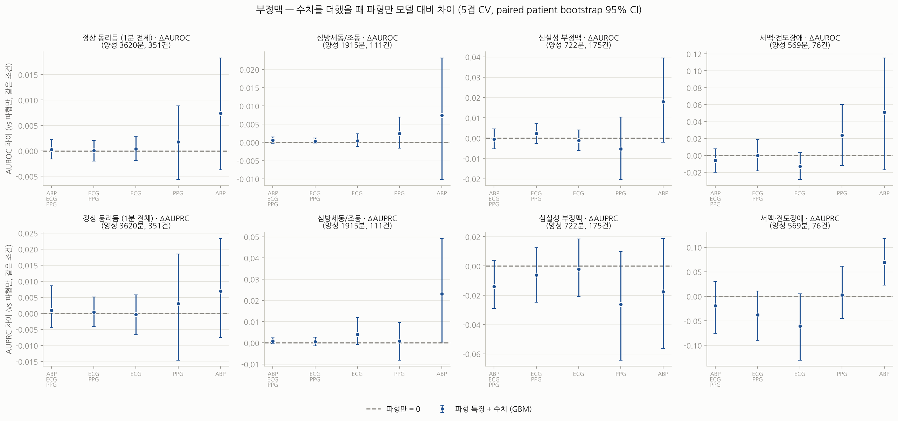
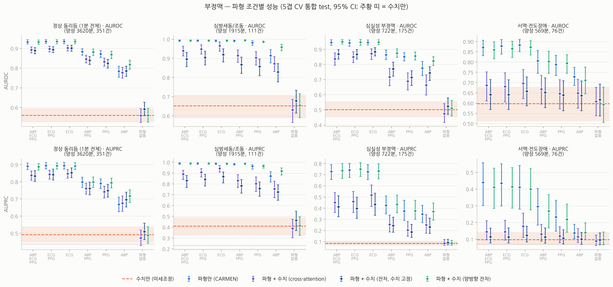
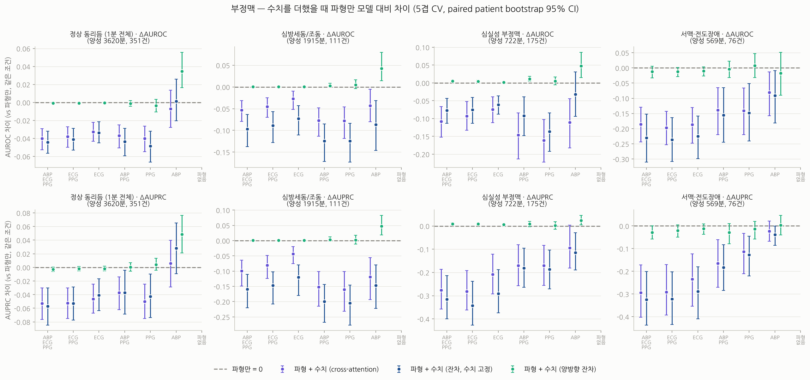
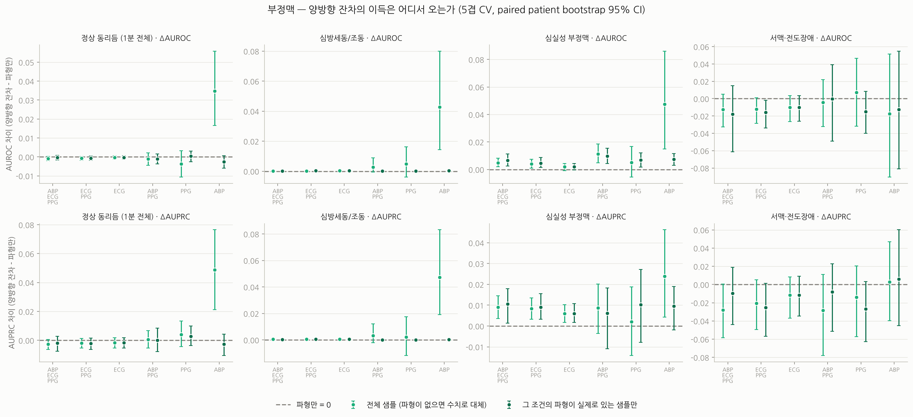

# 부정맥 — 파형이 본업인 과제에서 수치를 더하면 나아지는가 (2026-11-26)

연구 목표: **파형이 있으면 파형을, 수치만 있으면 수치를 쓴다.**
저혈압·케이스 단위 과제에서는 수치가 본업이었다. 이번에는 반대로 파형이 본업인 과제(부정맥)를 골라 두 가지를 확인했다.

- 파형에 수치를 더하면 나아지는가
- 수치만 있을 때 어디까지 되는가

이 문서는 두 부분이다.

- 앞부분: **고전적 파형 특징 + GBM** (CPU).
- 뒷부분 [CARMEN 파형 토큰 + 수치 encoder](#carmen-파형-토큰--수치-encoder-gpu): 같은 표본·같은 fold 에서 융합 구조 네 가지를 비교했다. **양방향 잔차**(bidir)가 여기에 들어간다.

**요약.**
- 수치가 주(主)인 융합(cross-attention, 수치 고정 잔차)은 이 과제에서 파형만보다 크게 나쁘다.
- 양방향 잔차는 파형이 있으면 파형만 수준을, 파형이 없으면 수치만 수준을 지킨다.

## 데이터와 과제

- **데이터**: VitalDB Arrhythmia Database (PhysioNet `vitaldb-arrhythmia` 1.0.0).
  - 케이스마다 약 20분 구간의 박동 단위 리듬 라벨이 있다.
  - 캐시에 있는 482 케이스 (473 환자) 를 썼다.
- **표본**: 라벨이 온전한 1분 행 하나 = 표본 하나, 총 **8,296분**.
  - 온전하다 = 박동 ≥ 20개, 5초를 넘는 공백 없음, `Unclassifiable` 박동 없음, 마취 시작 후 3분 이상.
- **라벨** (one-vs-rest, 그 1분 안에 **있으면** 양성):

| 라벨 | 정의 | 양성 |
| --- | --- | --: |
| 정상 동리듬 | 1분 내 모든 박동이 `N` | 3,620분 · 351 케이스 |
| 심방세동/조동 | `AFIB/AFL` 박동이 하나라도 | 1,915분 · 111 케이스 |
| 심실성 부정맥 | `VT` 또는 `Patterned Ventricular Ectopy` | 722분 · 175 케이스 |
| 서맥·전도장애 | `AVB` 또는 `SND` | 569분 · 76 케이스 |

- **입력**: 둘 다 같은 1분의 정보만 쓰고, 그 1분 이후는 보지 않는다.
  - 파형: 라벨과 같은 60초 창.
  - 수치: 그 1분 행까지의 모니터 기록.
- **평가**: 환자 단위 5겹 교차검증 (`cv_folds.py`).
  - StratifiedGroupKFold. 같은 환자는 한 fold 에만 들어가고, 케이스에 들어 있는 가장 드문 부정맥으로 층화한다.
  - 5개 fold 의 test 예측을 합쳐서 AUROC·AUPRC 를 계산한다.
  - 모델 간 차이는 같은 환자 재표집 1,000회의 짝지은 bootstrap 95% CI 로 낸다.

## 모델 (`scripts/wave_features.py`)

| 이름 | 입력 |
| --- | --- |
| 수치만 (`hand_gbm`) | 모니터 수치 요약 13개: 시각, HR 마지막·5분 평균/표준편차/최소/최대·15분 표준편차/기울기, SpO2, MAP 와 그 5분 변동, 맥압, EtCO2 |
| 파형 특징만 (`wf:<조건>`) | 아래 61개 중 그 조건에 있는 파형의 특징 |
| 파형 특징 + 수치 (`wfnum:<조건>`) | `wf:<조건>` + 수치 13개 |

모든 모델은 같은 GBM 을 쓴다 (`probe_ioh.gbm_probe`, HistGradientBoosting).
fold 의 train 부분으로 학습한다. 수치만 결과는 앞서 `compare_ioh.py` 로 따로 돌린 값과 소수점 셋째 자리까지 같다.

**파형 특징.**

- **입력 창**: CARMEN 토큰과 같은 창을 같은 전처리로 쓴다 (`extract_carmen_tokens.case_windows`: 100 Hz, ECG band-pass, ABP·PPG low-pass).
- **박동 검출**: 정답 라벨 없이 파형에서 직접 찾는다.
  - ECG: 미분 에너지를 150 ms 로 적분한 포락선의 봉우리 (Pan-Tompkins 방식).
  - ABP·PPG: 수축기 봉우리.
- **신호별 특징**
  - 간격 통계 13개: 박동 수, 심박수, CV, RMSSD, pNN50·pNN20, 간격의 lag-1 자기상관, 짧은·긴 간격 비율, 최장 정지, 최대/최소 비, 간격 히스토그램 엔트로피.
  - 형태 5개: 중앙 박동과의 상관 평균·하위 10%, 상관 < 0.8 비율, 잔차 에너지, 진폭 CV.
- **ECG 추가 5개**: QRS 포락선 폭(중앙·90%·넓은 박동 비율), P파 영역의 박동 간 일관성과 에너지.
- **교차 특징 2개**: ECG 박동 대비 ABP·PPG 맥박 결손.
- **신호가 없을 때**: 해당 특징은 결측으로 두고, GBM 이 처리한다.
  - ABP 는 창의 5–95% 범위가 10 mmHg 미만이면 없음으로 본다. 연결되지 않은 동맥관이 20–30 mmHg 잡음으로 범위 검사를 통과하기 때문이다.
- **검출기 점검** (모니터 HR 과의 차이가 ±5 bpm 이내인 창의 비율; 부정맥 창이 섞여 있어 완벽할 수 없다):

  | 신호 | 있는 창 | ±5 bpm 이내 | 중앙 오차 |
  | --- | --: | --: | --: |
  | ECG | 100% | 87.6% | 0.9 bpm |
  | ABP | 70.4% | 85.6% | 0.9 bpm |
  | PPG | 87.6% | 83.8% | 0.9 bpm |

## 결과




**AUROC.** 각 칸 = 파형 특징만 → 파형 특징 + 수치 (짝지은 차이 [95% CI]). **굵게** = CI 가 0 을 포함하지 않음.

| 라벨 | 수치만 | ABP+ECG+PPG | ECG+PPG | ECG | PPG | ABP |
| --- | --: | --: | --: | --: | --: | --: |
| 정상 동리듬 | 0.618 | 0.940 → 0.940 (+0.000 [−0.002, +0.002]) | 0.939 → 0.939 (+0.000 [−0.002, +0.002]) | 0.940 → 0.940 (+0.000 [−0.002, +0.003]) | 0.864 → 0.865 (+0.002 [−0.006, +0.009]) | 0.819 → 0.827 (+0.007 [−0.004, +0.018]) |
| 심방세동/조동 | 0.699 | 0.995 → 0.996 (+0.001 [−0.000, +0.001]) | 0.995 → 0.995 (+0.000 [−0.000, +0.001]) | 0.994 → 0.995 (+0.000 [−0.001, +0.002]) | 0.979 → 0.981 (+0.002 [−0.002, +0.007]) | 0.938 → 0.945 (+0.007 [−0.010, +0.023]) |
| 심실성 부정맥 | 0.542 | 0.936 → 0.936 (−0.000 [−0.005, +0.004]) | 0.931 → 0.933 (+0.002 [−0.003, +0.007]) | 0.931 → 0.930 (−0.001 [−0.006, +0.004]) | 0.826 → 0.821 (−0.005 [−0.020, +0.010]) | 0.792 → 0.810 (+0.018 [−0.002, +0.039]) |
| 서맥·전도장애 | 0.700 | 0.891 → 0.885 (−0.006 [−0.020, +0.008]) | 0.877 → 0.877 (−0.000 [−0.018, +0.019]) | 0.893 → 0.880 (−0.013 [−0.029, +0.003]) | 0.743 → 0.767 (+0.024 [−0.012, +0.060]) | 0.708 → 0.759 (+0.051 [−0.017, +0.115]) |

**AUPRC** (발생률: 정상 0.436 · AF 0.231 · 심실성 0.087 · 서맥·전도 0.069).

| 라벨 | 수치만 | ABP+ECG+PPG | ECG+PPG | ECG | PPG | ABP |
| --- | --: | --: | --: | --: | --: | --: |
| 정상 동리듬 | 0.542 | 0.910 → 0.911 (+0.001 [−0.004, +0.009]) | 0.910 → 0.911 (+0.000 [−0.004, +0.005]) | 0.913 → 0.912 (−0.000 [−0.007, +0.006]) | 0.786 → 0.789 (+0.003 [−0.015, +0.018]) | 0.732 → 0.739 (+0.007 [−0.008, +0.023]) |
| 심방세동/조동 | 0.447 | 0.990 → 0.991 (+0.001 [−0.000, +0.002]) | 0.989 → 0.989 (+0.000 [−0.001, +0.003]) | 0.983 → 0.987 (+0.004 [−0.001, +0.012]) | 0.944 → 0.944 (+0.001 [−0.008, +0.010]) | 0.866 → 0.889 (**+0.023 [+0.000, +0.049]**) |
| 심실성 부정맥 | 0.103 | 0.648 → 0.634 (−0.014 [−0.029, +0.004]) | 0.644 → 0.638 (−0.006 [−0.025, +0.012]) | 0.635 → 0.633 (−0.002 [−0.021, +0.018]) | 0.332 → 0.306 (−0.026 [−0.064, +0.010]) | 0.298 → 0.280 (−0.018 [−0.056, +0.019]) |
| 서맥·전도장애 | 0.130 | 0.482 → 0.463 (−0.019 [−0.076, +0.030]) | 0.469 → 0.432 (−0.038 [−0.090, +0.011]) | 0.511 → 0.451 (−0.060 [−0.130, +0.005]) | 0.197 → 0.200 (+0.003 [−0.045, +0.061]) | 0.131 → 0.200 (**+0.069 [+0.023, +0.118]**) |

## 해석

1. **ECG 파형이 있으면 수치는 아무것도 보태지 못한다.**
   - ECG 가 들어간 세 조건에서 네 라벨 모두 AUROC 차이가 0.000 ± 0.002 안팎이다.
   - 서맥·전도장애는 오히려 약간 나빠지는 쪽이다 (ECG 만: AUROC −0.013, AUPRC −0.060; CI 는 0 을 걸침).
     파형이 이미 다 설명하는 상황에서 13개 특징을 더하면, 표본이 작은 클래스(양성 76 케이스)에서 잡음만 늘어난다.
2. **ECG 없이 맥파(ABP 또는 PPG)만 있을 때만 수치가 조금 보탠다.**
   - CI 가 0 을 넘은 것은 ABP 만 있을 때의 두 개뿐이다: 서맥·전도장애 AUPRC +0.069, AF AUPRC +0.023.
   - 같은 조건에서 서맥·전도장애 AUROC +0.051, 심실성 AUROC +0.018 도 같은 방향이지만 유의하지는 않다.
   - 단, 이 수치 HR 은 모니터가 **ECG 에서** 계산한 값이다.
     "파형 기록에는 ECG 가 없지만 모니터에는 ECG 가 붙어 있는" 상황이라서 수치가 ECG 정보를 간접적으로 들여온 셈이다.
3. **수치만으로는 부정맥을 거의 잡지 못한다.**
   - 수치만 AUROC 는 0.54–0.70 이다. 같은 1분의 ECG 특징은 0.89–0.995 다.
   - 심실성 부정맥은 수치만으로는 사실상 무작위다 (0.542, AUPRC 0.103 vs 발생률 0.087).
   - 1분 집계 HR 에는 박동 간격의 불규칙성이 남지 않기 때문이다.
4. **설계에 주는 함의.**
   - 저혈압·케이스 과제와 정반대로, 여기서는 **파형이 주(主), 수치가 보조**다.
   - 따라서 융합 구조는 "주 modality 를 망가뜨리지 않고 다른 쪽을 잔차로 더하는" 형태가 맞다. 무엇이 주인지는 과제마다 다르다.
   - 수치만 남는 상황은 대체 경로(fallback)다. 이 과제에서 그 성능 상한은 AUROC 0.7 수준이다.

## CARMEN 파형 토큰 + 수치 encoder (GPU)

같은 8,296분, 같은 5겹 fold, 같은 환자 단위 짝지은 bootstrap 이다. 파형 입력만 손으로 만든 특징 대신 고정된 CARMEN 토큰을 쓴다.

| 이름 | 구조 |
| --- | --- |
| 수치만 (`numeric_ft`) | UniTTab 신호 전용 encoder 를 부정맥 라벨로 미세조정 (`finetune_ioh.py`) |
| 파형만 (`wave:<조건>`) | 고정된 CARMEN 토큰 (파형 조합별 인코딩) → head. 파형 조합을 무작위로 빼며 학습 |
| cross-attention (`fusion`) | 수치 query 가 CARMEN 토큰에 cross-attend, 처음부터 함께 학습 |
| 잔차, 수치 고정 (`gatef`) | 미세조정된 수치 모델을 고정하고, 그 출력에 파형 잔차를 더함 (저혈압에서 쓴 구조) |
| **양방향 잔차** (`bidir`) | 고정된 수치 모델과 파형만 모델의 출력을 **실제로 있는** 파형 조합 s 마다 섞는다: `a[s]·z_수치 + b[s]·z_파형 + c[s] + 잔차` |

**양방향 잔차의 세부.**
- 시작점: (파형 조합, 라벨)마다 val AUROC 가 높은 쪽 모델 하나를 그대로 쓴다.
- 잔차: 수치 query 가 CARMEN 토큰에 cross-attend 하는 블록이고, 마지막 층을 0 으로 초기화한다.
- 학습 전 상태(step 0)도 val 선택 후보에 들어간다. 그래서 val 에서 이득이 없으면 시작점이 그대로 남는다.

### 결과





**AUROC.** 각 칸 = 파형만 / cross-attention / 수치 고정 잔차 / **양방향 잔차**. 조건은 그 파형만 쓰도록 강제한 test 이고, 표본은 늘 8,296분 전체다.

| 라벨 | 수치만 | ABP+ECG+PPG | ECG | PPG | ABP | 파형 없음 |
| --- | --: | --: | --: | --: | --: | --: |
| 정상 동리듬 | 0.561 | 0.934 / 0.893 / 0.889 / 0.933 | 0.935 / 0.903 / 0.902 / 0.935 | 0.872 / 0.832 / 0.824 / 0.868 | 0.784 / 0.777 / 0.785 / 0.819 | — / 0.559 / 0.592 / 0.561 |
| 심방세동/조동 | 0.652 | 0.994 / 0.940 / 0.897 / 0.994 | 0.992 / 0.965 / 0.919 / 0.993 | 0.982 / 0.904 / 0.857 / 0.987 | 0.915 / 0.872 / 0.829 / 0.958 | — / 0.631 / 0.678 / 0.654 |
| 심실성 부정맥 | 0.502 | 0.946 / 0.838 / 0.869 / 0.950 | 0.946 / 0.871 / 0.885 / 0.948 | 0.851 / 0.690 / 0.714 / 0.856 | 0.776 / 0.664 / 0.744 / 0.823 | — / 0.475 / 0.524 / 0.511 |
| 서맥·전도장애 | 0.597 | 0.872 / 0.687 / 0.641 / 0.859 | 0.883 / 0.696 / 0.658 / 0.872 | 0.787 / 0.646 / 0.639 / 0.794 | 0.728 / 0.648 / 0.637 / 0.711 | — / 0.608 / 0.617 / 0.592 |

**AUPRC** (같은 순서).

| 라벨 | 수치만 | ABP+ECG+PPG | ECG | PPG | ABP | 파형 없음 |
| --- | --: | --: | --: | --: | --: | --: |
| 정상 동리듬 | 0.492 | 0.891 / 0.838 / 0.834 / 0.888 | 0.894 / 0.848 / 0.853 / 0.892 | 0.791 / 0.741 / 0.749 / 0.795 | 0.668 / 0.675 / 0.697 / 0.717 | — / 0.472 / 0.510 / 0.488 |
| 심방세동/조동 | 0.410 | 0.989 / 0.890 / 0.830 / 0.990 | 0.987 / 0.944 / 0.867 / 0.988 | 0.962 / 0.802 / 0.757 / 0.964 | 0.872 / 0.753 / 0.725 / 0.919 | — / 0.389 / 0.462 / 0.414 |
| 심실성 부정맥 | 0.084 | 0.727 / 0.451 / 0.412 / 0.737 | 0.726 / 0.518 / 0.435 / 0.732 | 0.374 / 0.203 / 0.187 / 0.376 | 0.345 / 0.251 / 0.231 / 0.369 | — / 0.087 / 0.092 / 0.086 |
| 서맥·전도장애 | 0.098 | 0.440 / 0.145 / 0.114 / 0.411 | 0.411 / 0.177 / 0.123 / 0.400 | 0.233 / 0.119 / 0.106 / 0.219 | 0.138 / 0.115 / 0.100 / 0.141 | — / 0.089 / 0.097 / 0.098 |

**양방향 잔차 − 파형만.** 각 칸 = 전체 표본 → 그 조건의 파형이 **실제로 있는** 표본만 (`present_subset.py`). **굵게** = CI 가 0 을 포함하지 않음.



| 라벨 | ABP+ECG+PPG | ECG | PPG | ABP |
| --- | --: | --: | --: | --: |
| 정상 동리듬 AUROC | −0.001 [−0.002, +0.000] → −0.000 [−0.002, +0.001] | −0.000 [−0.001, +0.001] → −0.000 [−0.001, +0.001] | −0.004 [−0.011, +0.003] → +0.000 [−0.002, +0.003] | **+0.035 [+0.017, +0.056]** → −0.003 [−0.006, +0.001] |
| 심방세동/조동 AUROC | **+0.000 [+0.000, +0.000]** → +0.000 [−0.000, +0.000] | **+0.000 [+0.000, +0.001]** → **+0.000 [+0.000, +0.001]** | +0.005 [−0.004, +0.016] → +0.000 [−0.000, +0.000] | **+0.043 [+0.014, +0.080]** → +0.000 [−0.000, +0.001] |
| 심실성 부정맥 AUROC | **+0.005 [+0.002, +0.008]** → **+0.007 [+0.003, +0.011]** | +0.002 [−0.001, +0.004] → +0.002 [−0.000, +0.004] | +0.005 [−0.005, +0.017] → **+0.007 [+0.002, +0.012]** | **+0.047 [+0.015, +0.086]** → **+0.007 [+0.003, +0.012]** |
| 서맥·전도장애 AUROC | −0.012 [−0.033, +0.005] → −0.018 [−0.061, +0.015] | −0.010 [−0.027, +0.003] → −0.010 [−0.026, +0.003] | +0.007 [−0.032, +0.047] → −0.015 [−0.040, +0.009] | −0.017 [−0.090, +0.051] → −0.012 [−0.081, +0.055] |
| 정상 동리듬 AUPRC | −0.003 [−0.006, +0.001] → −0.002 [−0.008, +0.003] | −0.002 [−0.005, +0.002] → −0.002 [−0.005, +0.002] | +0.004 [−0.004, +0.013] → +0.003 [−0.004, +0.010] | **+0.049 [+0.021, +0.077]** → −0.003 [−0.011, +0.004] |
| 심방세동/조동 AUPRC | **+0.001 [+0.000, +0.001]** → +0.000 [−0.000, +0.001] | **+0.001 [+0.000, +0.001]** → **+0.001 [+0.000, +0.001]** | +0.002 [−0.012, +0.017] → +0.000 [−0.001, +0.001] | **+0.047 [+0.019, +0.083]** → +0.000 [−0.000, +0.001] |
| 심실성 부정맥 AUPRC | **+0.009 [+0.004, +0.014]** → **+0.011 [+0.001, +0.018]** | **+0.006 [+0.002, +0.010]** → **+0.006 [+0.002, +0.011]** | +0.002 [−0.014, +0.019] → +0.010 [−0.008, +0.027] | **+0.024 [+0.004, +0.046]** → +0.010 [−0.002, +0.019] |
| 서맥·전도장애 AUPRC | −0.028 [−0.058, +0.001] → −0.010 [−0.044, +0.019] | −0.012 [−0.037, +0.008] → −0.012 [−0.035, +0.009] | −0.014 [−0.057, +0.020] → −0.027 [−0.063, +0.003] | +0.003 [−0.040, +0.047] → +0.006 [−0.045, +0.060] |

- 파형이 있는 표본 수: ABP+ECG+PPG 4,914 · ECG 8,296 · PPG 7,265 · ABP 5,843 (ABP 있음 70.4%, PPG 87.6%).
- 파형 없음 조건에서 양방향 잔차 − 수치만: AUROC −0.005 ~ +0.008, AUPRC −0.004 ~ +0.004. 네 라벨 모두 CI 가 0 을 포함한다.

### 해석

1. **수치가 주인 융합은 이 과제에서 무너진다.**
   - 서맥·전도장애 (ECG 만): 파형만 0.883 → cross-attention 0.696, 수치 고정 잔차 0.658.
   - 심실성 부정맥 AUPRC (ECG 만): 0.726 → 0.518, 0.435.
   - 저혈압에서는 "수치 고정 잔차" 가 수치 성능을 지키는 안전장치였다. 여기서는 같은 구조가 파형 정보를 다 쓰지 못한다.
   - 원인 가설 (확인 필요): 잔차 경로가 수치 출력 위의 작은 보정으로 시작한다. 그래서 파형이 주가 되어야 하는 과제에서는 거기까지 자라지 못한다.
2. **양방향 잔차는 두 상황을 다 지킨다.**
   - 파형이 있으면 파형만 수준이다. ECG 가 들어간 조건에서 AUROC 차이는 −0.012 ~ +0.005 다.
   - 파형이 없으면 수치만 수준이다 (위 목록).
   - 시작점 선택: 5겹 모두에서 파형이 하나라도 있는 조합은 파형 모델, 없는 조합은 수치 모델이 뽑혔다. 예외는 fold 3 의 (ABP 만, 서맥·전도장애) 한 칸뿐이다.
   - 잔차 학습은 val 에서 거의 이득이 없었다. 선택된 step 은 fold 별로 0·50·150·50·0 이다. 혼합 가중치도 시작값에서 0.013 넘게 움직이지 않았다.
   - 즉 이 과제의 양방향 잔차는 사실상 **실제로 있는 파형 조합에 따라 주 modality 를 고르는 선택기**로 동작했다.
3. **"ABP 만" 에서 보인 큰 이득 (AUROC +0.035 ~ +0.047) 은 대체(fallback) 효과다.**
   - ABP 가 실제로 있는 표본만 보면 정상 −0.003, AF +0.000, 서맥 −0.012 (CI 0 포함) 로 사라진다.
   - ABP 가 없는 29.6% 표본에서 파형만 모델은 입력이 없다. 양방향 잔차는 그 표본에서 수치로 넘어간다.
   - 이것이 연구 목표("파형이 있으면 파형, 수치만 있으면 수치") 그대로의 동작이다. 다만 "수치가 ABP 에 정보를 보탰다" 로 읽으면 안 된다.
4. **수치가 파형에 정말 보태는 몫은 작다.**
   - 심실성 부정맥에서만 일관되게 + 다 (파형 있는 표본 기준 AUROC +0.002 ~ +0.007, AUPRC +0.006 ~ +0.011, 대부분 CI > 0).
   - 서맥·전도장애는 약간 손해 쪽이다. ECG+PPG 에서 파형 있는 표본 기준 AUROC −0.016 [−0.034, −0.002] 이고, 나머지 조건은 CI 가 0 을 포함한다.
   - GBM 에서 유의했던 "ABP 만 + 수치" 이득 (서맥 AUPRC +0.069) 은 CARMEN 에서는 재현되지 않았다. CARMEN 의 ABP 표현이 이미 강하다 (ABP 있는 표본에서 AF AUROC 0.994).
5. **CARMEN 파형만 ≈ 손으로 만든 특징 GBM.** 아래는 파형만 AUROC / AUPRC 이고, 두 모델 사이의 짝지은 검정은 하지 않았다.

   | 라벨 | CARMEN ABP+ECG+PPG | GBM ABP+ECG+PPG | CARMEN ECG | GBM ECG |
   | --- | --: | --: | --: | --: |
   | 정상 동리듬 | 0.934 / 0.891 | 0.940 / 0.910 | 0.935 / 0.894 | 0.940 / 0.913 |
   | 심방세동/조동 | 0.994 / 0.989 | 0.995 / 0.990 | 0.992 / 0.987 | 0.994 / 0.983 |
   | 심실성 부정맥 | 0.946 / 0.727 | 0.936 / 0.648 | 0.946 / 0.726 | 0.931 / 0.635 |
   | 서맥·전도장애 | 0.872 / 0.440 | 0.891 / 0.482 | 0.883 / 0.411 | 0.893 / 0.511 |

   - 수치만은 미세조정 UniTTab (0.50–0.65) 이 수치 요약 GBM (0.54–0.70) 보다 약하다.

### 실행 환경 메모

- 실행 중 공유 Lustre 의 OST 하나(`lustre1-OST0016`)가 이 노드에서 응답하지 않았다. 그래서 노드 로컬 디스크로 옮겨 실행했다.
- 그 OST 위에 있던 입력은 공개 출처에서 다시 받거나 다시 만들었다.

  | 입력 | 처리 | 검증 |
  | --- | --- | --- |
  | 주석 13개 | PhysioNet 에서 다시 받음 | `SHA256SUMS.txt` 전부 일치 |
  | `.vital` 21개 | VitalDB API 에서 다시 받음 | 대조 3개가 바이트 단위로 같음 |
  | 수치 캐시 22개 | 다시 만듦 | 대조 2개가 배열 단위로 같음 |

- 그래서 입력은 GBM 실행과 같다.

## 한계

- 이 과제의 양방향 잔차는 선택기 이상의 일을 거의 하지 않았다 (해석 2). 잔차가 실제로 일하는 과제(저혈압 등)에서의 확인은 별도로 남아 있다.
- 시작점 선택은 val AUROC 로 한다. 양성이 적은 칸(서맥·전도장애 × ABP 만)에서는 fold 마다 선택이 뒤집힐 수 있다.
- **라벨은 "있음"(presence) 기준이다.**
  - 1분 안에 VT 박동이 한 번만 있어도 양성이다 (VT 지속 중앙값 1.5초).
  - CARMEN 사전학습의 30초 순수성 기준과는 다르다.
- 케이스마다 주석 구간이 약 20분이라서 같은 케이스의 분들은 서로 상관되어 있다. 그래서 bootstrap 은 환자 단위로 했다.
- 단일 seed, 단일 fold 분할 (seed 0).
- 수치 HR 이 ECG 에서 나온다는 점은 위에 적었다. 파형만 vs 수치만 비교는 같은 신호의 두 가지 요약을 견주는 셈이다.

## 재현

```bash
python scripts/cv_folds.py make --arr-dir $ARR --label-data $SIG --k 5 --out $R/folds_arr
python scripts/wave_features.py extract --arr-dir $ARR --label-data $SIG --cases-csv $CL \
    --vital-dir $BASE/vitaldb/raw --split $R/folds_arr/all.json --workers 6 --out $R/runs/arr_wfeat.npz
python scripts/wave_features.py cv --feats $R/runs/arr_wfeat.npz --folds $R/folds_arr \
    --out-prefix $R/runs/arr_cmp_wf_f
python scripts/cv_folds.py pool $R/runs/arr_cmp_wf_f{0,1,2,3,4}.npz --reference hand_gbm \
    --pair-prefix wf --label-data $SIG --n-boot 1000 --out $R/runs/arr_wf_cv.json
python scripts/plot_predictions.py arr_wf_cv.json --out figs --arr-gbm
```

CPU 세션에서 특징 추출은 89초 (6 worker), GBM 220개와 bootstrap 은 몇 분이면 끝난다.

**CARMEN 융합** (GPU 1장, 토큰 추출 12분 + fold 당 약 12분).

```bash
python scripts/extract_carmen_tokens.py --task arrhythmia --arr-dir $ARR --label-data $SIG \
    --vital-dir $BASE/vitaldb/raw --cases-csv $CL --carmen-src $R/carmen_src \
    --weights $R/carmen_weights/carmen-base.pt --out $TK --split $R/folds_arr/all.json \
    --splits train --subsets all --chunk-s 2 --workers 16 --batch-size 64
(cd $TK && for x in train_*; do ln -sf $x val_${x#train_}; ln -sf $x test_${x#train_}; done)
# fold f = 0..4
T="--task arrhythmia --arr-dir $ARR --cases-csv $CL --data $SIG --label-data $SIG --split $R/folds_arr/fold$f.json"
W="--token-mode subsets --ckpt $CK --tokens $TK --eval-every 50 --patience 10"
python scripts/finetune_ioh.py $T --ckpt $CK --lr-enc 1e-5 --lr-head 3e-4 --eval-every 50 --patience 10 \
    --out runs/arr_ft_f$f
python scripts/finetune_fusion.py --mode wave $T $W --subset-train 0.4 0.0 --select-conds eap ep e p \
    --out runs/arr_wave_f$f
python scripts/finetune_fusion.py --mode fusion $T $W --subset-train 0.4 0.15 \
    --select-conds eap ep e p none --out runs/arr_fusion_f$f
python scripts/finetune_fusion.py --mode gated --freeze-numeric --init-from runs/arr_ft_f$f/best.pt $T $W \
    --subset-train 0.4 0.15 --select-conds eap ep e p none --out runs/arr_gatef_f$f
python scripts/finetune_fusion.py --mode bidir --init-from runs/arr_ft_f$f/best.pt \
    --wave-from runs/arr_wave_f$f/best.pt $T $W --subset-train 0.4 0.15 \
    --select-conds eap ep e p none --out runs/arr_bidir_f$f
python scripts/compare_ioh.py $T --finetuned numeric_ft runs/arr_ft_f$f/best.pt --reference numeric_ft \
    --scores wave:<c> ... --scores fusion:<c> ... --scores gatef:<c> ... --scores bidir:<c> ... \
    --n-boot 100 --dump runs/arr_cmp_f$f.npz --out runs/arr_cmp_f$f.json
# pooled
python scripts/cv_folds.py pool runs/arr_cmp_f{0,1,2,3,4}.npz --reference numeric_ft --pair-prefix wave \
    --label-data $SIG --n-boot 1000 --out runs/arr_cv.json
python scripts/present_subset.py --dumps runs/arr_cmp_f{0,1,2,3,4}.npz --meta $TK/train_meta.npz \
    --label-data $SIG --out runs/arr_bidir_present.json
python scripts/plot_predictions.py arr_cv.json --arr --arr-present arr_bidir_present.json --out figs
```
