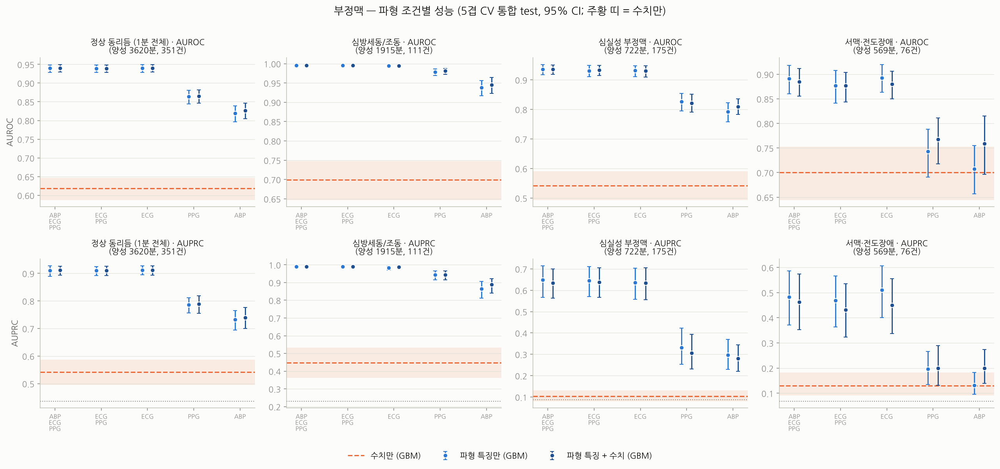

# 부정맥 — 파형이 본업인 과제에서 수치를 더하면 나아지는가 (2026-11-26)

연구 목표: **파형이 있으면 파형을, 수치만 있으면 수치를 쓴다.**
저혈압·케이스 단위 과제에서는 수치가 본업이었다. 이번에는 반대로 파형이 본업인 과제(부정맥)를 골라 두 가지를 확인했다.

- 파형에 수치를 더하면 나아지는가
- 수치만 있을 때 어디까지 되는가

> 이 문서는 **고전적 파형 특징 + GBM** 결과다 (GPU 없이 CPU 로 수행).
> CARMEN 파형 토큰과 수치 encoder 를 융합한 비교(`run_arr_gpu.sh`: wave / cross-attn / 잔차 융합)는 아직 돌리지 못했다.
> 노드의 GPU 8장이 모두 다른 세션에 잡혀 있었다. 그 결과는 이 문서에 이어서 붙인다.

## 데이터와 과제

- **데이터**: VitalDB Arrhythmia Database (PhysioNet `vitaldb-arrhythmia` 1.0.0).
  - 케이스마다 약 20분 구간의 박동 단위 리듬 라벨이 있다.
  - 캐시에 있는 482 케이스 (473 환자) 를 썼다.
- **표본**: 라벨이 온전한 1분 행 하나 = 표본 하나, 총 **8,296분**.
  - 온전하다 = 박동 ≥ 20개, 5초를 넘는 공백 없음, `Unclassifiable` 박동 없음, 마취 시작 후 3분 이상.
- **라벨** (one-vs-rest, 그 1분 안에 **있으면** 양성):

| 라벨 | 정의 | 양성 |
| --- | --- | --: |
| 정상 동리듬 | 1분 내 모든 박동이 `N` | 3,620분 · 351 케이스 |
| 심방세동/조동 | `AFIB/AFL` 박동이 하나라도 | 1,915분 · 111 케이스 |
| 심실성 부정맥 | `VT` 또는 `Patterned Ventricular Ectopy` | 722분 · 175 케이스 |
| 서맥·전도장애 | `AVB` 또는 `SND` | 569분 · 76 케이스 |

- **입력**: 둘 다 같은 1분의 정보만 쓰고, 그 1분 이후는 보지 않는다.
  - 파형: 라벨과 같은 60초 창.
  - 수치: 그 1분 행까지의 모니터 기록.
- **평가**: 환자 단위 5겹 교차검증 (`cv_folds.py`).
  - StratifiedGroupKFold. 같은 환자는 한 fold 에만 들어가고, 케이스에 들어 있는 가장 드문 부정맥으로 층화한다.
  - 5개 fold 의 test 예측을 합쳐서 AUROC·AUPRC 를 계산한다.
  - 모델 간 차이는 같은 환자 재표집 1,000회의 짝지은 bootstrap 95% CI 로 낸다.

## 모델 (`scripts/wave_features.py`)

| 이름 | 입력 |
| --- | --- |
| 수치만 (`hand_gbm`) | 모니터 수치 요약 13개: 시각, HR 마지막·5분 평균/표준편차/최소/최대·15분 표준편차/기울기, SpO2, MAP 와 그 5분 변동, 맥압, EtCO2 |
| 파형 특징만 (`wf:<조건>`) | 아래 61개 중 그 조건에 있는 파형의 특징 |
| 파형 특징 + 수치 (`wfnum:<조건>`) | `wf:<조건>` + 수치 13개 |

모든 모델은 같은 GBM 을 쓴다 (`probe_ioh.gbm_probe`, HistGradientBoosting).
fold 의 train 부분으로 학습한다. 수치만 결과는 앞서 `compare_ioh.py` 로 따로 돌린 값과 소수점 셋째 자리까지 같다.

**파형 특징.**

- **입력 창**: CARMEN 토큰과 같은 창을 같은 전처리로 쓴다 (`extract_carmen_tokens.case_windows`: 100 Hz, ECG band-pass, ABP·PPG low-pass).
- **박동 검출**: 정답 라벨 없이 파형에서 직접 찾는다.
  - ECG: 미분 에너지를 150 ms 로 적분한 포락선의 봉우리 (Pan-Tompkins 방식).
  - ABP·PPG: 수축기 봉우리.
- **신호별 특징**
  - 간격 통계 13개: 박동 수, 심박수, CV, RMSSD, pNN50·pNN20, 간격의 lag-1 자기상관, 짧은·긴 간격 비율, 최장 정지, 최대/최소 비, 간격 히스토그램 엔트로피.
  - 형태 5개: 중앙 박동과의 상관 평균·하위 10%, 상관 < 0.8 비율, 잔차 에너지, 진폭 CV.
- **ECG 추가 5개**: QRS 포락선 폭(중앙·90%·넓은 박동 비율), P파 영역의 박동 간 일관성과 에너지.
- **교차 특징 2개**: ECG 박동 대비 ABP·PPG 맥박 결손.
- **신호가 없을 때**: 해당 특징은 결측으로 두고, GBM 이 처리한다.
  - ABP 는 창의 5–95% 범위가 10 mmHg 미만이면 없음으로 본다. 연결되지 않은 동맥관이 20–30 mmHg 잡음으로 범위 검사를 통과하기 때문이다.
- **검출기 점검** (모니터 HR 과의 차이가 ±5 bpm 이내인 창의 비율; 부정맥 창이 섞여 있어 완벽할 수 없다):

  | 신호 | 있는 창 | ±5 bpm 이내 | 중앙 오차 |
  | --- | --: | --: | --: |
  | ECG | 100% | 87.6% | 0.9 bpm |
  | ABP | 70.4% | 85.6% | 0.9 bpm |
  | PPG | 87.6% | 83.8% | 0.9 bpm |

## 결과




**AUROC.** 각 칸 = 파형 특징만 → 파형 특징 + 수치 (짝지은 차이 [95% CI]). **굵게** = CI 가 0 을 포함하지 않음.

| 라벨 | 수치만 | ABP+ECG+PPG | ECG+PPG | ECG | PPG | ABP |
| --- | --: | --: | --: | --: | --: | --: |
| 정상 동리듬 | 0.618 | 0.940 → 0.940 (+0.000 [−0.002, +0.002]) | 0.939 → 0.939 (+0.000 [−0.002, +0.002]) | 0.940 → 0.940 (+0.000 [−0.002, +0.003]) | 0.864 → 0.865 (+0.002 [−0.006, +0.009]) | 0.819 → 0.827 (+0.007 [−0.004, +0.018]) |
| 심방세동/조동 | 0.699 | 0.995 → 0.996 (+0.001 [−0.000, +0.001]) | 0.995 → 0.995 (+0.000 [−0.000, +0.001]) | 0.994 → 0.995 (+0.000 [−0.001, +0.002]) | 0.979 → 0.981 (+0.002 [−0.002, +0.007]) | 0.938 → 0.945 (+0.007 [−0.010, +0.023]) |
| 심실성 부정맥 | 0.542 | 0.936 → 0.936 (−0.000 [−0.005, +0.004]) | 0.931 → 0.933 (+0.002 [−0.003, +0.007]) | 0.931 → 0.930 (−0.001 [−0.006, +0.004]) | 0.826 → 0.821 (−0.005 [−0.020, +0.010]) | 0.792 → 0.810 (+0.018 [−0.002, +0.039]) |
| 서맥·전도장애 | 0.700 | 0.891 → 0.885 (−0.006 [−0.020, +0.008]) | 0.877 → 0.877 (−0.000 [−0.018, +0.019]) | 0.893 → 0.880 (−0.013 [−0.029, +0.003]) | 0.743 → 0.767 (+0.024 [−0.012, +0.060]) | 0.708 → 0.759 (+0.051 [−0.017, +0.115]) |

**AUPRC** (발생률: 정상 0.436 · AF 0.231 · 심실성 0.087 · 서맥·전도 0.069).

| 라벨 | 수치만 | ABP+ECG+PPG | ECG+PPG | ECG | PPG | ABP |
| --- | --: | --: | --: | --: | --: | --: |
| 정상 동리듬 | 0.542 | 0.910 → 0.911 (+0.001 [−0.004, +0.009]) | 0.910 → 0.911 (+0.000 [−0.004, +0.005]) | 0.913 → 0.912 (−0.000 [−0.007, +0.006]) | 0.786 → 0.789 (+0.003 [−0.015, +0.018]) | 0.732 → 0.739 (+0.007 [−0.008, +0.023]) |
| 심방세동/조동 | 0.447 | 0.990 → 0.991 (+0.001 [−0.000, +0.002]) | 0.989 → 0.989 (+0.000 [−0.001, +0.003]) | 0.983 → 0.987 (+0.004 [−0.001, +0.012]) | 0.944 → 0.944 (+0.001 [−0.008, +0.010]) | 0.866 → 0.889 (**+0.023 [+0.000, +0.049]**) |
| 심실성 부정맥 | 0.103 | 0.648 → 0.634 (−0.014 [−0.029, +0.004]) | 0.644 → 0.638 (−0.006 [−0.025, +0.012]) | 0.635 → 0.633 (−0.002 [−0.021, +0.018]) | 0.332 → 0.306 (−0.026 [−0.064, +0.010]) | 0.298 → 0.280 (−0.018 [−0.056, +0.019]) |
| 서맥·전도장애 | 0.130 | 0.482 → 0.463 (−0.019 [−0.076, +0.030]) | 0.469 → 0.432 (−0.038 [−0.090, +0.011]) | 0.511 → 0.451 (−0.060 [−0.130, +0.005]) | 0.197 → 0.200 (+0.003 [−0.045, +0.061]) | 0.131 → 0.200 (**+0.069 [+0.023, +0.118]**) |

## 해석

1. **ECG 파형이 있으면 수치는 아무것도 보태지 못한다.**
   - ECG 가 들어간 세 조건에서 네 라벨 모두 AUROC 차이가 0.000 ± 0.002 안팎이다.
   - 서맥·전도장애는 오히려 약간 나빠지는 쪽이다 (ECG 만: AUROC −0.013, AUPRC −0.060; CI 는 0 을 걸침).
     파형이 이미 다 설명하는 상황에서 13개 특징을 더하면, 표본이 작은 클래스(양성 76 케이스)에서 잡음만 늘어난다.
2. **ECG 없이 맥파(ABP 또는 PPG)만 있을 때만 수치가 조금 보탠다.**
   - CI 가 0 을 넘은 것은 ABP 만 있을 때의 두 개뿐이다: 서맥·전도장애 AUPRC +0.069, AF AUPRC +0.023.
   - 같은 조건에서 서맥·전도장애 AUROC +0.051, 심실성 AUROC +0.018 도 같은 방향이지만 유의하지는 않다.
   - 단, 이 수치 HR 은 모니터가 **ECG 에서** 계산한 값이다.
     "파형 기록에는 ECG 가 없지만 모니터에는 ECG 가 붙어 있는" 상황이라서 수치가 ECG 정보를 간접적으로 들여온 셈이다.
3. **수치만으로는 부정맥을 거의 잡지 못한다.**
   - 수치만 AUROC 는 0.54–0.70 이다. 같은 1분의 ECG 특징은 0.89–0.995 다.
   - 심실성 부정맥은 수치만으로는 사실상 무작위다 (0.542, AUPRC 0.103 vs 발생률 0.087).
   - 1분 집계 HR 에는 박동 간격의 불규칙성이 남지 않기 때문이다.
4. **설계에 주는 함의.**
   - 저혈압·케이스 과제와 정반대로, 여기서는 **파형이 주(主), 수치가 보조**다.
   - 따라서 융합 구조는 "주 modality 를 망가뜨리지 않고 다른 쪽을 잔차로 더하는" 형태가 맞다. 무엇이 주인지는 과제마다 다르다.
   - 수치만 남는 상황은 대체 경로(fallback)다. 이 과제에서 그 성능 상한은 AUROC 0.7 수준이다.

## 한계

- 이 비교는 **고전적 특징 + GBM** 이다.
  - CARMEN 표현에서도 같은 결론이 나오는지는 GPU 실행으로 확인해야 한다.
  - 다만 ECG 특징만으로 AF 0.995 이므로, 어떤 파형 모델이든 ECG 가 있는 조건에서는 수치가 비집고 들어갈 여지가 거의 없다.
- **라벨은 "있음"(presence) 기준이다.**
  - 1분 안에 VT 박동이 한 번만 있어도 양성이다 (VT 지속 중앙값 1.5초).
  - CARMEN 사전학습의 30초 순수성 기준과는 다르다.
- 케이스마다 주석 구간이 약 20분이라서 같은 케이스의 분들은 서로 상관되어 있다. 그래서 bootstrap 은 환자 단위로 했다.
- 단일 seed, 단일 fold 분할 (seed 0).
- 수치 HR 이 ECG 에서 나온다는 점은 위에 적었다. 파형만 vs 수치만 비교는 같은 신호의 두 가지 요약을 견주는 셈이다.

## 재현

```bash
python scripts/cv_folds.py make --arr-dir $ARR --label-data $SIG --k 5 --out $R/folds_arr
python scripts/wave_features.py extract --arr-dir $ARR --label-data $SIG --cases-csv $CL \
    --vital-dir $BASE/vitaldb/raw --split $R/folds_arr/all.json --workers 6 --out $R/runs/arr_wfeat.npz
python scripts/wave_features.py cv --feats $R/runs/arr_wfeat.npz --folds $R/folds_arr \
    --out-prefix $R/runs/arr_cmp_wf_f
python scripts/cv_folds.py pool $R/runs/arr_cmp_wf_f{0,1,2,3,4}.npz --reference hand_gbm \
    --pair-prefix wf --label-data $SIG --n-boot 1000 --out $R/runs/arr_wf_cv.json
python scripts/plot_predictions.py arr_wf_cv.json --out figs --arr-gbm
```

CPU 세션에서 특징 추출은 89초 (6 worker), GBM 220개와 bootstrap 은 몇 분이면 끝난다.
