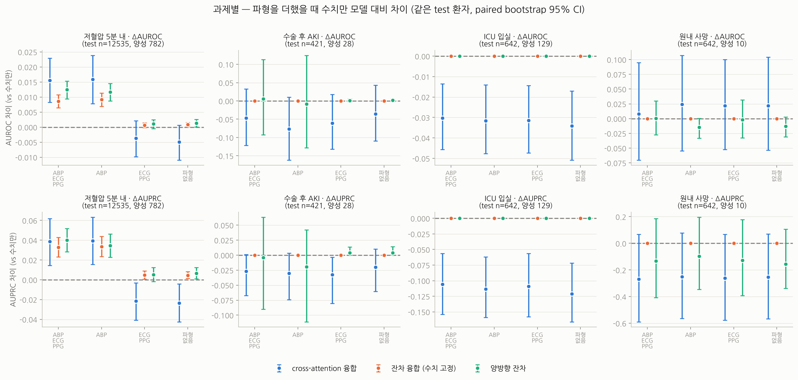

# 양방향 잔차 (bidir) — 주 modality 를 과제와 파형 조합마다 고르는 융합 (2026-11-26)

연구 목표: **파형이 있으면 파형을, 수치만 있으면 수치를 쓴다.**

앞서 쓴 융합 두 가지는 둘 다 수치가 주(主)였다.

- cross-attention (`fusion`): 수치 query 가 CARMEN 토큰을 본다.
- 수치 고정 잔차 (`gatef`): 고정된 수치 모델 출력에 파형 잔차를 더한다.

저혈압·케이스 과제에서는 수치가 주라서 문제가 없었다. 하지만 부정맥처럼 파형이 주인 과제에서는 둘 다 크게 무너졌다 ([부정맥 결과](2026-11-26_arrhythmia.md)).
양방향 잔차는 **어느 쪽이 주인지를 데이터에서 고른다.**

## 구조 (`finetune_fusion.py --mode bidir`)

```
z = a[s] · z_수치 + b[s] · z_파형 + c[s] + 잔차
```

- `z_수치`: 미세조정된 수치 모델 (`--init-from`). 고정한다.
- `z_파형`: 파형만 모델 (`--mode wave`, `--wave-from`). 고정한다.
- `s`: 그 표본에 **실제로 있는** 파형 조합 (ECG 1 · ABP 2 · PPG 4 의 비트합, 0–7).
- `a, b, c`: (조합, 라벨)마다 하나씩이다.
  - 시작값: val AUROC 가 높은 쪽이 1, 다른 쪽이 0 이다.
  - val 표본은 강제 조건 전체를 모아 실제 조합별로 나눈다.
  - 양성이 10 미만인 칸은 수치를 고른다.
- 잔차: 수치 query 가 CARMEN 토큰에 cross-attend 하는 블록이고, 마지막 층을 0 으로 초기화한다.
- 학습 전 상태(step 0)도 val 선택 후보에 들어간다. 그래서 학습이 val 에서 이득이 없으면 시작점이 그대로 남는다.

## 과제별로 고른 주 modality

| 과제 | 주 modality (시작점) | 선택된 step (val AUROC: step 0 → 선택) |
| --- | --- | --- |
| 부정맥 (5겹) | 파형이 하나라도 있으면 **파형**, 없으면 수치 (예외 1칸) | 0 · 50 · 150 · 50 · 0 (변화 ≤ 0.006) |
| 저혈압 | 모든 조합에서 **수치** | 400 (0.8627 → 0.8647) |
| AKI | ABP 가 든 조합(a · ea · ap · eap)은 **파형**, 나머지는 수치 | 50 (0.7926 → 0.7943) |
| ICU 입실 | 모든 조합에서 **수치** | 0 (학습 없음과 같음) |
| 원내 사망 | 모든 조합에서 **수치** | 250 (0.8803 → 0.9107) |

부정맥과 저혈압에서는 같은 규칙이 정반대의 주 modality 를 골랐다.
AKI 의 "ABP 조합은 파형" 선택은 val 양성이 적어서 생긴 우연으로 보인다. test 에서 AKI 파형만 AUROC 는 0.60 으로 수치만 0.687 보다 낮다.

## 결과 (test, 같은 환자 paired bootstrap 95% CI)



**AUROC — 수치만 대비 차이.** 각 칸 = cross-attention / 수치 고정 잔차 / **양방향 잔차**. **굵게** = CI 가 0 을 포함하지 않음.

| 과제 | 수치만 | ABP+ECG+PPG | ABP 만 | ECG+PPG | 파형 없음 |
| --- | --: | --: | --: | --: | --: |
| 저혈압 5분 내 | 0.866 | **+0.016 [+0.008, +0.023]**<br>**+0.009 [+0.007, +0.011]**<br>**+0.012 [+0.009, +0.015]** | **+0.016 [+0.008, +0.024]**<br>**+0.009 [+0.007, +0.011]**<br>**+0.012 [+0.009, +0.015]** | −0.004 [−0.010, +0.002]<br>+0.001 [−0.000, +0.001]<br>+0.001 [−0.000, +0.003] | −0.005 [−0.011, +0.001]<br>**+0.001 [+0.000, +0.002]**<br>**+0.001 [+0.000, +0.003]** |
| 수술 후 AKI | 0.687 | −0.047 [−0.122, +0.033]<br>+0.000 [+0.000, +0.000]<br>+0.005 [−0.093, +0.114] | −0.077 [−0.162, +0.010]<br>+0.000 [+0.000, +0.000]<br>−0.008 [−0.128, +0.124] | −0.061 [−0.131, +0.017]<br>+0.000 [+0.000, +0.000]<br>+0.001 [−0.003, +0.005] | −0.035 [−0.110, +0.043]<br>+0.000 [+0.000, +0.000]<br>+0.002 [−0.002, +0.006] |
| ICU 입실 | 0.903 | **−0.030 [−0.046, −0.014]**<br>+0.000 [+0.000, +0.000]<br>+0.000 [−0.000, +0.000] | **−0.032 [−0.048, −0.014]**<br>+0.000 [+0.000, +0.000]<br>+0.000 [−0.000, +0.000] | **−0.031 [−0.047, −0.014]**<br>+0.000 [+0.000, +0.000]<br>+0.000 [−0.000, +0.000] | **−0.034 [−0.051, −0.017]**<br>+0.000 [+0.000, +0.000]<br>+0.000 [−0.000, +0.000] |
| 원내 사망 | 0.769 | +0.008 [−0.070, +0.095]<br>+0.000 [+0.000, +0.000]<br>+0.000 [−0.027, +0.030] | +0.024 [−0.054, +0.107]<br>+0.000 [+0.000, +0.000]<br>−0.014 [−0.033, +0.000] | +0.022 [−0.052, +0.100]<br>+0.000 [+0.000, +0.000]<br>−0.002 [−0.032, +0.032] | +0.022 [−0.054, +0.104]<br>+0.000 [+0.000, +0.000]<br>−0.013 [−0.031, +0.002] |

**AUPRC — 수치만 대비 차이** (같은 순서).

| 과제 | 수치만 | ABP+ECG+PPG | ABP 만 | ECG+PPG | 파형 없음 |
| --- | --: | --: | --: | --: | --: |
| 저혈압 5분 내 | 0.391 | **+0.039 [+0.014, +0.062]**<br>**+0.033 [+0.023, +0.043]**<br>**+0.040 [+0.028, +0.052]** | **+0.039 [+0.015, +0.063]**<br>**+0.034 [+0.024, +0.044]**<br>**+0.034 [+0.023, +0.046]** | **−0.021 [−0.041, −0.003]**<br>**+0.005 [+0.001, +0.009]**<br>+0.005 [−0.002, +0.012] | **−0.024 [−0.043, −0.004]**<br>**+0.005 [+0.001, +0.008]**<br>**+0.007 [+0.001, +0.012]** |
| 수술 후 AKI | 0.131 | −0.027 [−0.067, +0.001]<br>+0.000 [+0.000, +0.000]<br>−0.004 [−0.090, +0.063] | −0.030 [−0.074, +0.003]<br>+0.000 [+0.000, +0.000]<br>−0.019 [−0.111, +0.042] | **−0.033 [−0.080, −0.004]**<br>+0.000 [+0.000, +0.000]<br>**+0.004 [+0.000, +0.014]** | −0.020 [−0.060, +0.010]<br>+0.000 [+0.000, +0.000]<br>**+0.004 [+0.000, +0.014]** |
| ICU 입실 | 0.769 | **−0.106 [−0.154, −0.056]**<br>+0.000 [+0.000, +0.000]<br>+0.000 [−0.000, +0.002] | **−0.114 [−0.159, −0.062]**<br>+0.000 [+0.000, +0.000]<br>+0.000 [−0.000, +0.002] | **−0.109 [−0.158, −0.056]**<br>+0.000 [+0.000, +0.000]<br>+0.000 [−0.000, +0.002] | **−0.121 [−0.166, −0.072]**<br>+0.000 [+0.000, +0.000]<br>+0.000 [−0.000, +0.002] |
| 원내 사망 | 0.361 | −0.268 [−0.590, +0.067]<br>+0.000 [+0.000, +0.000]<br>−0.133 [−0.407, +0.186] | −0.251 [−0.564, +0.078]<br>+0.000 [+0.000, +0.000]<br>−0.097 [−0.346, +0.195] | −0.260 [−0.577, +0.069]<br>+0.000 [+0.000, +0.000]<br>−0.128 [−0.392, +0.178] | −0.254 [−0.566, +0.069]<br>+0.000 [+0.000, +0.000]<br>−0.155 [−0.338, +0.106] |

**양방향 잔차와 기존 융합의 직접 비교.** 각 칸 = 양방향 잔차 − 수치 고정 잔차 / 양방향 잔차 − cross-attention (같은 조건, 같은 재표집).

| 과제 · 지표 | ABP+ECG+PPG | ABP 만 | ECG+PPG | 파형 없음 |
| --- | --: | --: | --: | --: |
| 저혈압 AUROC | **+0.004 [+0.002, +0.005]** / −0.003 [−0.009, +0.002] | **+0.002 [+0.001, +0.004]** / −0.004 [−0.010, +0.001] | +0.000 [−0.001, +0.002] / +0.005 [−0.001, +0.010] | +0.000 [−0.001, +0.001] / **+0.006 [+0.000, +0.012]** |
| 저혈압 AUPRC | **+0.007 [+0.001, +0.014]** / +0.001 [−0.018, +0.021] | +0.001 [−0.004, +0.007] / −0.005 [−0.025, +0.015] | +0.000 [−0.005, +0.006] / **+0.027 [+0.009, +0.044]** | +0.002 [−0.002, +0.006] / **+0.030 [+0.012, +0.047]** |
| AKI AUROC | +0.005 [−0.102, +0.116] / +0.052 [−0.036, +0.143] | −0.008 [−0.123, +0.120] / +0.068 [−0.020, +0.155] | +0.001 [−0.003, +0.006] / +0.062 [−0.012, +0.135] | +0.002 [−0.002, +0.006] / +0.037 [−0.039, +0.110] |
| ICU AUROC | +0.000 [−0.000, +0.000] / **+0.030 [+0.014, +0.047]** | +0.000 [−0.000, +0.000] / **+0.032 [+0.015, +0.048]** | +0.000 [−0.000, +0.000] / **+0.031 [+0.014, +0.048]** | +0.000 [−0.000, +0.000] / **+0.034 [+0.017, +0.052]** |
| 사망 AUROC | +0.000 [−0.028, +0.041] / −0.008 [−0.146, +0.075] | −0.014 [−0.037, +0.001] / −0.039 [−0.180, +0.049] | −0.002 [−0.035, +0.042] / −0.024 [−0.154, +0.056] | −0.013 [−0.036, +0.005] / −0.035 [−0.170, +0.047] |

저혈압 10·15분 (양방향 잔차 − 수치만, AUROC):
- 10분: ABP+ECG+PPG +0.008 [+0.006, +0.010], 파형 없음 +0.002 [+0.001, +0.004].
- 15분: +0.005 [+0.003, +0.006], 파형 없음 +0.002 [+0.000, +0.003].

부정맥 (5겹 CV, 파형이 주인 과제)은 [부정맥 문서](2026-11-26_arrhythmia.md#carmen-파형-토큰--수치-encoder-gpu)에 있다.
- 파형이 있으면 양방향 잔차 ≈ 파형만이다 (ECG 조건 AUROC −0.012 ~ +0.005).
- 같은 조건에서 cross-attention·수치 고정 잔차는 최대 −0.23 까지 떨어진다.

## 해석

1. **한 구조로 두 방향의 과제를 다 지킨 것은 양방향 잔차뿐이다.**

   | 과제 | 주 modality | cross-attention | 수치 고정 잔차 | 양방향 잔차 |
   | --- | --- | --- | --- | --- |
   | 부정맥 | 파형 | 크게 손해 | 크게 손해 | 파형만 수준 |
   | 저혈압 | 수치 | ABP 없을 때 손해 | 지킴 | 지킴 |
   | ICU | 수치 | 전 조건 손해 | 지킴 | 지킴 |

2. **저혈압에서는 양방향 잔차가 두 기존 구조의 좋은 점을 합쳤다.**
   - ABP 가 있으면 수치 고정 잔차보다 낫다 (AUROC +0.004, AUPRC +0.007, 모두 CI > 0). cross-attention 과는 차이가 없다 (−0.003, CI 0 포함).
   - ABP 가 없으면 cross-attention 보다 낫다 (AUPRC +0.027 ~ +0.030). 수치만과도 같거나 조금 낫다.
3. **케이스 과제에서는 사실상 수치만이다.**
   - ICU 는 step 0 이 선택되어 수치만과 완전히 같다.
   - AKI · 사망은 test 양성이 28 · 10 명이다. 차이의 CI 가 ±0.1 이상이라 결론을 낼 수 없다.
4. **val 기반 선택의 약점이 양성이 적은 과제에서 드러났다.**
   - AKI: ABP 조합의 주 modality 가 파형으로 뒤집혔다. 그래서 ABP 조건의 CI 가 다른 조건보다 20배 넓다.
   - 사망: 잔차가 val 에서 0.880 → 0.911 로 올랐지만, test 에서는 수치만보다 약간 낮다 (AUROC −0.013, AUPRC −0.13, 모두 CI 0 포함). 과적합으로 보인다.
   - 대책 후보 (확인 필요): 시작점 선택에 최소 양성 수를 높이기 (현재 10), 조합 간 가중치 공유, 잔차 학습률 축소, 교차검증으로 선택.

## 한계

- 부정맥만 5겹 CV 다. 저혈압·케이스 과제는 단일 분할이다.
- seed 는 하나다.
- 파형만 모델은 과제마다 새로 학습했다 (`fu_wave_sub_<task>`).
  - 저혈압 파형만 모델은 3000 step 까지 val 이 계속 오르고 있었다 (0.73). 더 학습하면 결과가 달라질 수 있다.
- IOH 토큰(45 GB)이 남은 GPU 메모리에 들어가지 않았다. 그래서 `--token-device cpu` 로 토큰을 호스트 메모리에 두고 배치만 GPU 로 옮겼다. 계산 결과는 같다 (로컬 smoke 에서 test 점수 차이 0).

## 재현 (노드)

```bash
# task = ioh / aki / icu / mortality
# G = 그 과제의 수치 고정 잔차 실행 (fu_gatef_ioh, fu_gatef_case_<task>)
# C = G/result.json 의 args 중 mode·init_from·freeze_numeric·out·subset_train·select_conds 를 뺀 나머지
# NUM = G 의 init_from (수치만 체크포인트). ioh 는 C 에 --token-device cpu 를 붙였다.
python scripts/finetune_fusion.py --mode wave $C --subset-train 0.4 0.0 --select-conds eap ep \
  --out $R/runs/fu_wave_sub_$task
python scripts/finetune_fusion.py --mode bidir $C --init-from $NUM \
  --wave-from $R/runs/fu_wave_sub_$task/best.pt --subset-train 0.4 0.15 --select-conds eap ep none \
  --out $R/runs/fu_bidir_$task
python scripts/compare_ioh.py $T --finetuned numeric_ft $NUM \
  --scores wave:<c> ... --scores fusion:<c> ... --scores gatef:<c> ... --scores bidir:<c> ... \
  --reference numeric_ft --n-boot 1000 --dump $R/runs/compare_bidir_$task.npz \
  --out $R/runs/compare_bidir_$task.json
python scripts/cv_folds.py pool $R/runs/compare_bidir_$task.npz --reference numeric_ft \
  --pair-prefix gatef --label-data $SIG --n-boot 1000 --out $R/runs/compare_bidir_${task}_vs_gatef.json
# (--pair-prefix fusion 도 같은 방식)
python scripts/plot_predictions.py compare_bidir_icu.json --out figs --task-delta-bidir bidir \
  --task-delta '저혈압 5분 내' compare_bidir_ioh.json 5 fusion gatef \
  --task-delta '수술 후 AKI' compare_bidir_aki.json aki fusion gatef \
  --task-delta 'ICU 입실' compare_bidir_icu.json icu fusion gatef \
  --task-delta '원내 사망' compare_bidir_mortality.json mortality fusion gatef
```
